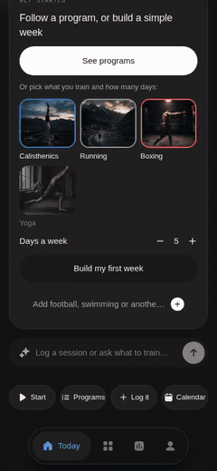

# Personal OS

Personal OS is a mobile-first life operating system for planning and managing the everyday parts of life: routines, finance, skincare, food, fashion, and daily habits.

It is built as a Bun + Turborepo monorepo with a product-focused Expo app, a Cloudflare Workers API, a documentation app, and a web landing page.

<p align="center">
  
</p>

<p align="center">
  <a href=".github/assets/showcase.mp4"><b>Watch the 70-second walkthrough (MP4)</b></a> ·
  Overview, calendar, training programs, exercise demos, a live session and insights.
</p>

## Why this project exists

Most people track life in disconnected tools: notes, finance apps, shopping lists, routines, and personal health data live in separate places. Personal OS brings those systems together into a single daily operating layer.

## What's in the app

Every area is a module you turn on during onboarding or later. Each has its own Home, insights
and an ask bar that logs or answers in plain words; everything works offline on the phone and
syncs to your account.

| Module | What it does |
| --- | --- |
| **Overview** | Money at a glance, the minimum day, what's next from your live plan, and a seven-day calendar |
| **Calendar** | One calendar for the whole app: training sessions and program weeks, interviews and follow-ups, bill due days, and your own events |
| **Daily life** | Plan the day, the minimum day with a streak, sleep, a morning brief and an evening close |
| **Training** | Programs with progression, your own activities and exercises, live sessions, insights (below) |
| **Career** | Job applications, follow-ups, interview prep, flashcards and a skill path |
| **Finance** | Spending, budget, bills, income and runway |
| **Food** | Meals, goals, recipes, a grocery list and barcode scanning |
| **Care** | Skin, hair and body routines, a product shelf and check-ins |
| **Faith** | Prayer times and logs, Qibla, recitation, tasbih and zakat |
| **Fashion** | Wardrobe, weather-aware outfits and a wishlist |
| **Wishlist** | Dreams with savings backed by Finance |

### Training

- **Programs:** twelve ready-made ones (Hybrid Athlete, Calisthenics Foundations, Handstand,
  First Muscle-up, Front Lever, Legs + Pistol, 5 km under 25, 10 km Build, Boxing Conditioning,
  Lean + Fit, Mobility + Recovery, Gym Strength), or design your own by hand or with AI.
- **Progression:** every exercise has a rep range; hit the top on every set and the next session
  adds a rep, then moves you to a harder variation (incline push-up → push-up → … → one-arm), or
  adds 2.5 kg for gym lifts. Light weeks, and test weeks that set your targets.
- **Built around your life:** days a week, session length, your equipment, and fixed days for
  the things you already do (a match, a class); legs never land the day before a match.
- **Activities you define:** football, swimming, climbing or anything else, with the numbers you
  want to track (goals, laps, routes).
- **Exercise library:** 85 exercises with cues, 45 with photo demos; add your own exercises,
  photos and GIF animations (Cloudflare R2), and Google Drive videos played in Drive's player.
- **Live sessions:** the demo, a countdown for holds, rest timers with an alert when the phone is
  locked, pause, and weights for gym lifts.
- **Insights:** readiness from sleep and recent effort, an AI weekly review, progress per exercise,
  bests with estimated one-rep max, sets by movement, consistency and activity totals.

## Product architecture

This monorepo is organized around a few core parts:

- Mobile app: `apps/mobile` — Expo / React Native app, the primary product experience
- API: `apps/api` — Hono app running on Cloudflare Workers with AI-powered capabilities
- Docs: `apps/docs` — Fumadocs site for product and engineering documentation
- Web: `apps/web` — landing page / public shell, built as a static export
- Shared design system: `packages/tokens` — design tokens and visual primitives
- Shared tooling: `scripts/`, `.devcontainer/`, CI and project hooks

## Tech stack

- Bun + Turborepo
- Expo / React Native
- Next.js
- Hono on Cloudflare Workers
- TypeScript
- Postgres / Drizzle
- Cloudflare R2 and Hyperdrive
- Design tokens and mobile-first UI system

## Repository layout

```text
personal-os/
├── apps/
│   ├── mobile/          # Expo app — product surface
│   ├── api/             # Hono API on Cloudflare Workers
│   ├── docs/            # Documentation site
│   └── web/             # Landing page
├── packages/
│   ├── tokens/          # Shared design tokens
│   ├── typescript-config/
│   └── logger/
├── scripts/             # Architecture, checks, hooks
├── docker/              # Postgres setup
├── .agents/             # Agent coordination + policies
├── .devcontainer/       # Dev container setup
├── .github/workflows/   # CI/CD
├── DESIGN.md            # Visual/design source of truth
├── PROJECT.md           # Product/engineering context
├── AGENTS.md            # AI-agent instructions
├── README.md            # This file
├── LICENSE-MIT
├── LICENSE-Apache-2.0
└── package.json
```

## Getting started

### Prerequisites

- [Bun](https://bun.sh) 1.4.2+
- Optional: Docker for local Postgres

### Install and run

```bash
git clone https://github.com/shabirkhan-dev/personal-os.git
cd personal-os
bun install
bun run prepare
bun run dev
```

### Local development URLs

- Expo / Metro: http://localhost:8081
- API: http://localhost:4000/api/v1/health
- Docs: http://localhost:3002/docs
- Landing page: http://localhost:3000

## Build the Android app

The app builds on EAS (Expo Application Services). A preview build is an installable APK:

```bash
cd apps/mobile
EAS_BUILD_PROFILE=preview bunx eas-cli build --profile preview --platform android
```

`EAS_BUILD_PROFILE` must be set locally too: `app.config.js` builds only `arm64-v8a` and shrinks
the code for preview builds, and the local and cloud configs must match. The API address comes from
`EXPO_PUBLIC_API_URL` in the project's EAS "preview" environment.

## Local API setup

```bash
docker compose up -d
cp apps/api/.dev.vars.example apps/api/.dev.vars
bun --cwd=apps/api run db:migrate
bun --cwd=apps/api run dev
```

## Common commands

```bash
bun run dev
bun run build
bun run lint
bun run lint:fix
bun run format
bun run typecheck
bun run test
bun run test:coverage
bun run architecture:check
bun run naming:check
```

## Docs and design

The project documentation lives in the docs app and is served locally at:

- http://localhost:3002/docs

Main docs and references:

- `/docs/quick-start`
- `/docs/architecture`
- `/docs/docker`
- `/docs/deploy`
- `/docs/product-system-design`
- `/docs/production-roadmap`

Design rules live in `DESIGN.md` and are the source of truth for the app UI and system tokens.

## Credits

Exercise demo photos are from [free-exercise-db](https://github.com/yuhonas/free-exercise-db),
released into the public domain under The Unlicense.

## License

This project is dual-licensed under:

- MIT
- Apache-2.0

Choose either at your option.
