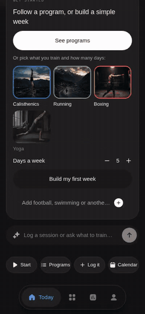

# Personal OS

Personal OS is a mobile-first life operating system for planning and managing the everyday parts of life: your day, training, career, money, food, care, faith, fashion and the things you're saving for, on one calendar.

It is built as a Bun + Turborepo monorepo with a product-focused Expo app, a Cloudflare Workers API, a documentation app, and a web landing page.

<p align="center">
  
</p>

<p align="center">
  <a href=".github/assets/showcase.mp4"><b>Watch the 70-second walkthrough (MP4)</b></a> ·
  Overview, calendar, training programs, exercise demos, a live session and insights.
</p>

## Download

**Android:** get the latest APK from [Releases](https://github.com/shabirkhan-dev/personal-os/releases/latest),
open it on your phone and allow the install once. Android 8 or newer, 64-bit phones. A new
release installs over the old one and keeps your data. iPhone builds aren't published yet.

## Why this project exists

Most people track life in disconnected tools: notes, finance apps, shopping lists, routines, and personal health data live in separate places. Personal OS brings those systems together into a single daily operating layer.

## How it works

- **It starts empty.** Nothing is filled in for you. Each module offers three ways in: add your
  own, let AI draft it (a budget, a day plan, a Care routine, a training program, a meal plan),
  or start from a template. A Getting started card on Home walks through the modules you picked.
- **Your own AI key, if you like.** Add a key from OpenRouter (free models included), OpenAI or
  any OpenAI-compatible provider in Profile → Your AI key. It stays in the phone's keystore and
  AI calls go straight from the phone to your provider, no account needed. Without one, AI runs
  through your signed-in account.
- **Templates made by you, with any AI.** Nothing ships with the app: no stock recipes,
  programs, exercises or photos. Templates → pick what to make (recipes, a training program,
  exercises, a Care routine, tasbih, flashcards, a challenge, a budget, a minimum day) → copy the
  prompt into ChatGPT, Claude or Gemini and paste the reply back, or let your own AI key make it
  right there. You see a preview and pick what to add. Your own recipe, routine, program or
  budget goes to a friend as a `.posx.json` file too.
- **Private by default.** Everything lives on the phone in an encrypted database (SQLCipher, key
  in the secure keystore), with an optional fingerprint or face lock, privacy mode that blocks
  screenshots, and no cloud backups of the app's data. Signing in is only for sync and AI.
- **Reminders that don't get lost.** Prayers, medicines (with Taken and Snooze buttons and a
  follow-up if you don't mark one), Care routines, water and a Sunday weekly review. Exact alarms
  on Android, re-planned in the background so they never run out.
- **Your data, your file.** Back up everything (photos too) to a file or a folder, daily if you
  like, and restore it by merging or replacing.
- **Search and your week.** One search across everything you saved, and a weekly review of the
  last seven days with a few plain suggestions.
- **Home-screen widgets** on Android: Today, Water (+250 ml), Tasbih and Money left.

## What's in the app

Every area is a module you turn on during onboarding or later. Each has its own Home, insights
and an ask bar that logs or answers in plain words; everything works offline on the phone and
syncs to your account.

| Module | What it does |
| --- | --- |
| **Overview** | Getting started, search, your week, money at a glance, the minimum day, what's next and a seven-day calendar |
| **Calendar** | One calendar for the whole app: training sessions and program weeks, interviews and follow-ups, bill due days, and your own events |
| **Daily life** | Plan the day (by hand or with AI), your own minimum day with a streak, sleep, a morning brief and an evening close |
| **Training** | Programs with progression, your own activities and exercises, live sessions, insights (below) |
| **Career** | Job applications, follow-ups, interview prep, flashcards and a skill path |
| **Finance** | Spending, a budget you set or design with AI, bills, income and runway |
| **Food** | Meals you choose, your own recipes with photos and steps, meal plans, a grocery list and barcode scanning |
| **Care** | Skin, hair and body routines with how-to and photos, a product shelf and check-ins |
| **Faith** | Prayer times and logs, Qibla, recitation, tasbih and zakat |
| **Health** | Medicines and supplements with reminders, vitals, check-ups, labs, symptoms, a records vault, and Health Connect / Apple Health sync |
| **Fashion** | Wardrobe, weather-aware outfits and a wishlist |
| **Wishlist** | Dreams with savings backed by Finance |

### Training

- **Programs:** design your own by hand, have AI draft one (it writes the exercises it needs),
  or import one made with any AI from Templates.
- **Progression:** every exercise has a range; hit the target on every set and the next session
  asks for a rep more, or 2.5 kg more for gym lifts. Light weeks, and test weeks that set your
  targets.
- **Built around your life:** days a week, session length, your equipment, and fixed days for
  the things you already do (a match, a class); legs never land the day before a match.
- **Activities you define:** football, swimming, climbing or anything else, with the numbers you
  want to track (goals, laps, routes).
- **Your exercises:** each with three cues, your photos and GIF animations, and Google Drive
  videos played in Drive's player; add them by hand or import a set made with any AI.
- **Live sessions:** your photo or animation, a countdown for holds, rest timers with an alert when the phone is
  locked, pause, and weights for gym lifts.
- **Insights:** readiness from sleep and recent effort, an AI weekly review, progress per exercise,
  bests with estimated one-rep max, sets by movement, consistency and activity totals.

## Product architecture

This monorepo is organized around a few core parts:

- Mobile app: `apps/mobile` — Expo / React Native app, the primary product experience
- API: `apps/api` — one Hono app on Cloudflare Workers: email-code sign-in, sync, R2 uploads and
  the AI for every module (the provider key stays in the Worker)
- Docs: `apps/docs` — Fumadocs site for product and engineering documentation
- Web: `apps/web` — landing page / public shell, built as a static export
- Shared AI: `packages/ai` — every AI task's prompt and schema, run by the API and, with a
  person's own key, by the phone
- Shared models: `packages/domain` — record shapes and parsing used by both the app and the API
- Shared design system: `packages/tokens` — design tokens and visual primitives
- Shared tooling: `scripts/`, `.devcontainer/`, CI and project hooks

## Tech stack

- Bun + Turborepo
- Expo / React Native
- Next.js
- Hono on Cloudflare Workers
- TypeScript
- Postgres / Drizzle
- Cloudflare R2 and Hyperdrive
- Design tokens and mobile-first UI system

## Repository layout

```text
personal-os/
├── apps/
│   ├── mobile/          # Expo app — product surface
│   ├── api/             # Hono API on Cloudflare Workers
│   ├── docs/            # Documentation site
│   └── web/             # Landing page
├── packages/
│   ├── ai/              # AI task prompts and schemas (API + phone with your own key)
│   ├── domain/          # Shared models and parsing (app + API)
│   ├── tokens/          # Shared design tokens
│   ├── typescript-config/
│   └── logger/
├── scripts/             # Architecture, checks, hooks
├── docker/              # Postgres setup
├── .agents/             # Agent coordination + policies
├── .devcontainer/       # Dev container setup
├── .github/workflows/   # CI/CD
├── DESIGN.md            # Visual/design source of truth
├── PROJECT.md           # Product/engineering context
├── AGENTS.md            # AI-agent instructions
├── README.md            # This file
├── LICENSE-MIT
├── LICENSE-Apache-2.0
└── package.json
```

## Getting started

### Prerequisites

- [Bun](https://bun.sh) 1.4.2+
- Optional: Docker for local Postgres

### Install and run

```bash
git clone https://github.com/shabirkhan-dev/personal-os.git
cd personal-os
bun install
bun run prepare
bun run dev
```

### Local development URLs

- Expo / Metro: http://localhost:8081
- API: http://localhost:4000/api/v1/health
- Docs: http://localhost:3002/docs
- Landing page: http://localhost:3000

## Build the Android app

**Release APK (what GitHub Releases ships):** push a version tag and the `Release` workflow builds
the APK and attaches it to a GitHub release.

```bash
git tag v0.7.0 && git push origin v0.7.0
```

**On your machine** (JDK 21 and the Android SDK):

```bash
cd apps/mobile
EAS_BUILD_PROFILE=preview EXPO_PUBLIC_API_URL=https://your-api.example.com \
  bunx expo prebuild --platform android --clean
cd android && ./gradlew assembleRelease   # app/build/outputs/apk/release/app-release.apk
```

**On EAS:** `EAS_BUILD_PROFILE=preview bunx eas-cli build --profile preview --platform android`.

`EAS_BUILD_PROFILE=preview` builds only `arm64-v8a` and shrinks the code, so the APK stays small;
the local and cloud configs must match. The API address is baked in from `EXPO_PUBLIC_API_URL`.

## Tests

- `bun run test`: unit tests across the workspace (the API's run against Postgres).
- `apps/mobile/e2e`: Maestro flows on an Android emulator (first launch, templates, reminders,
  backup, security, search and review), run by the `E2E` workflow on `main` and nightly.

## Local API setup

```bash
docker compose up -d
cp apps/api/.dev.vars.example apps/api/.dev.vars
bun --cwd=apps/api run db:migrate
bun --cwd=apps/api run dev
```

## Common commands

```bash
bun run dev
bun run build
bun run lint
bun run lint:fix
bun run format
bun run typecheck
bun run test
bun run test:coverage
bun run architecture:check
bun run naming:check
```

## Docs and design

The project documentation lives in the docs app and is served locally at:

- http://localhost:3002/docs

Main docs and references:

- `/docs/quick-start`
- `/docs/backend-api`
- `/docs/architecture`
- `/docs/docker`
- `/docs/deploy`
- `/docs/product-system-design`
- `/docs/production-roadmap`

Design rules live in `DESIGN.md` and are the source of truth for the app UI and system tokens.

## Contributing

Issues and pull requests are welcome. Read [AGENTS.md](AGENTS.md) (it applies to people too):
Bun only, Conventional Commits in lowercase, `bun run lint`, `bun run typecheck` and
`bun run test` before you push. UI follows [DESIGN.md](DESIGN.md) and the tokens in
`packages/tokens`, with no raw colours. New screens start empty: no sample data.

## License

This project is dual-licensed under:

- MIT
- Apache-2.0

Choose either at your option.
